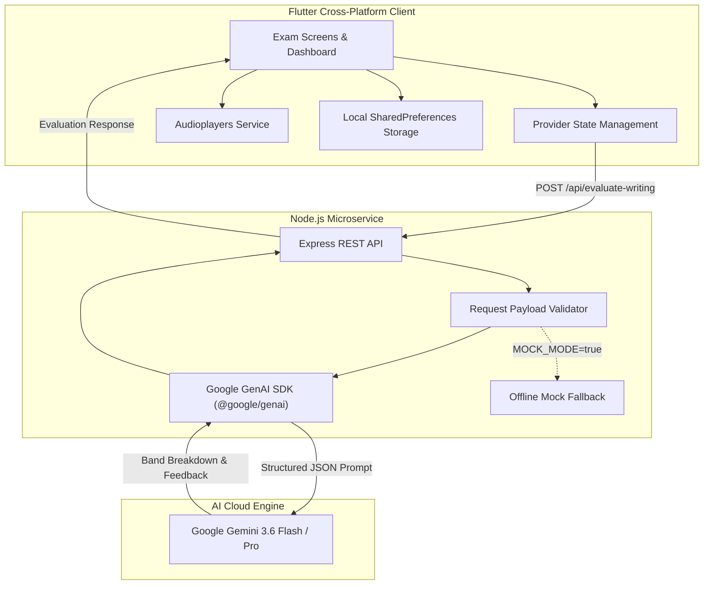

# IELTS Master — All-in-One IELTS Practice & Preparation Platform

<div align="center">


<p align="center">
  <strong>A modern, full-stack IELTS preparation suite featuring authentic exam simulations for Listening, Reading, and AI-powered Writing assessment with Cambridge-standard band analytics.</strong>
</p>

</div>

---

> [!WARNING]
> ### 🚧 Project Status: Under Active Development (Beta)
> This platform is currently in **Active Development (WIP)**. While core testing features (audio sync, split-view reading, and Gemini AI writing evaluation) are functional and tested, additional test sets, speaking modules, and cloud sync features are actively being integrated.

---

## 📌 Executive Summary

**IELTS Master** is a comprehensive computer-delivered IELTS preparation platform built with **Flutter** for cross-platform responsiveness and backed by a **Node.js** microservice that leverages **Google Gemini AI** for automated essay evaluation. 

The platform is designed to mirror the actual British Council / IDP Computer-Delivered IELTS exam UI, providing test-takers with realistic test timing, audio controls, split-pane reading navigation, and instant band scoring with actionable feedback.

---

## 🎯 Key Features & Modules

### 1. 🎧 IELTS Listening Simulation
- **Authentic Cambridge Listening Tests:** Full Section 1 to Section 4 audio tracks with corresponding question formats (Form Completion, Table Completion, Multiple Choice, Map Labeling).
- **Interactive Audio Controller:** Custom audio player with seamless play/pause, scrub bar, skip controls, and time elapsed/remaining indicators.
- **Split-Screen Layout:** Responsive question paper view paired with a question navigator bar showing completed, flagged, and pending items.
- **Transcript Synchronizer:** Post-test audio script with highlighted answers for thorough error analysis.
- **Instant Band Score Calculator:** Automated raw-to-band score conversion based on official Cambridge IELTS scales.

### 2. 📖 IELTS Reading Module
- **Split-Pane Passage Reader:** Side-by-side reading passage and question paper with resizable draggable splitters.
- **Interactive Highlighter:** Highlight key text passages to identify supporting evidence.
- **Multiple Question Typologies:** True/False/Not Given, Yes/No/Not Given, Matching Headings, Summary Completion, and Sentence Completion.
- **Exam Countdown Timer:** 60-minute strict exam timer with auto-submit capabilities.

### 3. ✍️ AI-Powered IELTS Writing Examiner (Google Gemini)
- **Official Exam Environment:** Full support for **Task 1** (Report/Visual Data Analysis, 150+ words) and **Task 2** (Discursive Essay, 250+ words).
- **Live Word Counter:** Dedicated word counter with minimum threshold indicator.
- **Local Persistence Fail-Safe:** Built with `WritingAttemptStorage` via `shared_preferences`—user essays are saved offline before submission so progress is never lost if network drops.
- **Gemini AI Evaluation Engine:** Node.js Express backend communicating with Google's Gemini models using structured JSON schemas to provide official 4-criterion band descriptors:
  - **Task Achievement / Task Response (TR):** Band score & detailed qualitative review.
  - **Coherence & Cohesion (CC):** Paragraph linking, coherence strengths, and transitions.
  - **Lexical Resource (LR):** Vocabulary range, advanced phrase recommendations, and repeated word detector with high-band synonym alternatives.
  - **Grammatical Range & Accuracy (GRA):** Itemized grammar corrections with original sentence, corrected version, grammar category, and comprehensive explanation.
  - **Sentence Upgrade Lab:** Sentence-by-sentence before/after analysis illustrating how to rewrite intermediate sentences into Band 8.0+ academic prose.
  - **Personalized 3-Tier Improvement Plan:** Actionable steps tailored to the user's weaknesses (High, Medium, Low priority).

### 4. 📊 Unified Student Dashboard
- **Progress Tracking:** Overall average band score, tests completed, and study duration.
- **Recent Test History:** Review past listening and reading attempts with detailed scorecards.
- **Quick Resume:** Jump directly back into in-progress tests.

---

## 🏗️ Architecture & Technology Stack



### Technology Breakdown

| Component | Technology | Purpose |
| :--- | :--- | :--- |
| **Frontend Framework** | Flutter 3.13+ (Dart) | Multi-platform application (Windows, Web, Android, iOS) |
| **State Management** | `provider` (^6.1.5) | Reactive test state, navigation, and audio sync |
| **Audio Engine** | `audioplayers` (^6.8.1) | Real-time playback of Cambridge listening test tracks |
| **Local Storage** | `shared_preferences` (^2.5.5) | Offline essay caching & attempt persistence |
| **Typography & Theme** | `google_fonts` (^8.2.1) | Clean, exam-standard readable typography |
| **Backend API** | Node.js + Express.js | Microservice handling AI requests securely |
| **AI Evaluation** | `@google/genai` | Structured schema generation with Gemini AI models |
| **Audio Processing** | Python 3 (`merge_audio.py`) | Automation script for concatenating Cambridge audio segments |

---

## 📂 Repository Structure

```text
ielts-practice-platform/
├── listening/                          # Main Flutter Application & Backend
│   ├── assets/                         # Application Assets
│   │   ├── audio/                      # Full Cambridge Listening Audio (Tests 1, 2, 3)
│   │   ├── data/                       # Cambridge Test Data (JSON format)
│   │   └── images/                     # Test illustrations & maps
│   ├── backend/                        # Node.js Express Writing Evaluation API
│   │   ├── .env.example                # Template for Gemini API configuration
│   │   ├── package.json                # Backend dependencies
│   │   ├── server.js                   # Express server & Gemini evaluation schema
│   │   └── README.md                   # Backend documentation
│   ├── lib/                            # Flutter Dart Source Code
│   │   ├── models/                     # Null-safe data models (Test, Writing, Result)
│   │   ├── providers/                  # Provider state managers
│   │   ├── screens/                    # Exam screens (Listening, Reading, Writing, Dashboard)
│   │   ├── services/                   # Storage & API services (Evaluation Service, Local Storage)
│   │   ├── theme/                      # Standardized colors, spacing, typography
│   │   ├── widgets/                    # Reusable components (AudioPlayer, SplitView, Highlighter)
│   │   └── main.dart                   # Application entry point
│   ├── daily_work_report.md            # Daily development work record
│   └── pubspec.yaml                    # Flutter dependencies & assets config
├── reading book/                       # Cambridge 19 Reading Test source pages & assets
├── writing/                            # IELTS Writing sample prompts & criteria
├── merge_audio.py                      # Python tool to merge multi-part MP3 files
├── .gitignore                          # Comprehensive ignore rules (keeps secrets safe)
└── README.md                           # Master Documentation & Setup Guide
```

---

## 📝 Development Work Log & Record

Below is an excerpt from the project development logs documenting milestones and system enhancements:

```markdown
Role: Flutter & Full-Stack Developer
Module: IELTS Writing Result Screen, Local Storage, Node.js Backend & Gemini AI Integration

✅ Designed and implemented the IELTS Writing Result / AI Evaluation screen.
✅ Preserved the existing approved Writing Test screen and its Task 1 / Task 2 layout.
✅ Added realistic mock IELTS evaluation data with complete band score breakdown.
✅ Added grammar, vocabulary, repeated words, coherence, sentence analysis, and improvement plan sections.
✅ Created null-safe Dart models for Gemini structured JSON responses.
✅ Added WritingAttempt model with pending, analyzing, completed, and failed AI statuses.
✅ Saved writing attempts locally (offline cache) before starting AI evaluation.
✅ Created a separate Node.js and Express backend for writing evaluation.
✅ Added the /api/evaluate-writing endpoint with request validation.
✅ Connected Flutter Submit flow with the Node.js evaluation backend.
✅ Added loading and AI evaluation failure states while preserving user essays.
✅ Added offline mock mode (MOCK_MODE=true) for zero-cost backend testing without Gemini.
✅ Protected the backend .env file from being committed to Git.
✅ Tested backend health endpoint and live Gemini evaluation successfully.
```

---

## 🚀 Getting Started & Installation

### Prerequisites

- [Flutter SDK](https://docs.flutter.dev/get-started/install) (`v3.13` or higher)
- [Node.js](https://nodejs.org/) (`v18` or higher)
- [Google Gemini API Key](https://aistudio.google.com/) (Required for AI Writing Evaluation)

---

### Step 1: Clone the Repository

```bash
git clone https://github.com/Haseeb-ML/ielts-practice-platform.git
cd ielts-practice-platform
```

---

### Step 2: Configure & Start the Backend Service

1. Open a terminal and navigate to the backend directory:
   ```bash
   cd listening/backend
   npm install
   ```

2. Configure environment variables:
   ```bash
   cp .env.example .env
   ```
   Open `.env` and insert your Gemini API Key:
   ```env
   PORT=8787
   GEMINI_API_KEY=your_actual_gemini_api_key_here
   GEMINI_MODEL=gemini-3.6-flash
   MOCK_MODE=false
   ```
   *(Set `MOCK_MODE=true` if you wish to test the UI offline without calling the Gemini API).*

3. Start the API server:
   ```bash
   npm start
   ```
   *The server will start listening at `http://localhost:8787`.*

---

### Step 3: Run the Flutter Application

1. Open a new terminal and navigate to the Flutter project:
   ```bash
   cd listening
   ```

2. Fetch Flutter packages:
   ```bash
   flutter pub get
   ```

3. Launch the app on your preferred platform:
   ```bash
   # Run on Windows Desktop
   flutter run -d windows

   # Run on Chrome Web
   flutter run -d chrome

   # Run on Connected Android device
   flutter run -d android
   ```

---

## 🗺️ Roadmap & Upcoming Milestones

- [x] Computer-delivered Listening test simulation with sync audio.
- [x] Computer-delivered Reading test with draggable split-view and highlighter.
- [x] Computer-delivered Writing test with dual-task support and live word count.
- [x] Gemini AI automated essay grading with 4-criterion IELTS Band breakdown.
- [x] Offline local attempt storage with auto-save.
- [ ] **Speaking Test Module:** Interactive voice-based interview recorder with speech-to-text pronunciation analysis.
- [ ] **Cloud Sync & User Authentication:** Firebase / Supabase integration for multi-device test history sync.
- [ ] **Cambridge 14–19 Test Library Expansion:** Adding remaining Cambridge test series data.
- [ ] **Dark Mode Support:** Theme toggle for night practice sessions.

---

## 🔒 Security & Privacy Notice

- **API Key Security:** The Google Gemini API key is strictly maintained backend-side in `listening/backend/.env`. It is **never** compiled into the Flutter client binary or committed to version control.
- **Data Privacy:** User essays submitted for evaluation are processed using the official Google GenAI endpoint and are not shared with third-party tracking services.

---

## 👨‍💻 Author & Contributions

- **Lead Developer:** Muhammad Haseeb ([@Haseeb-ML](https://github.com/Haseeb-ML))
- **Role:** Flutter & AI Application Developer

---

## 📄 License

This project is licensed under the [MIT License](LICENSE) — see the LICENSE file for details.

